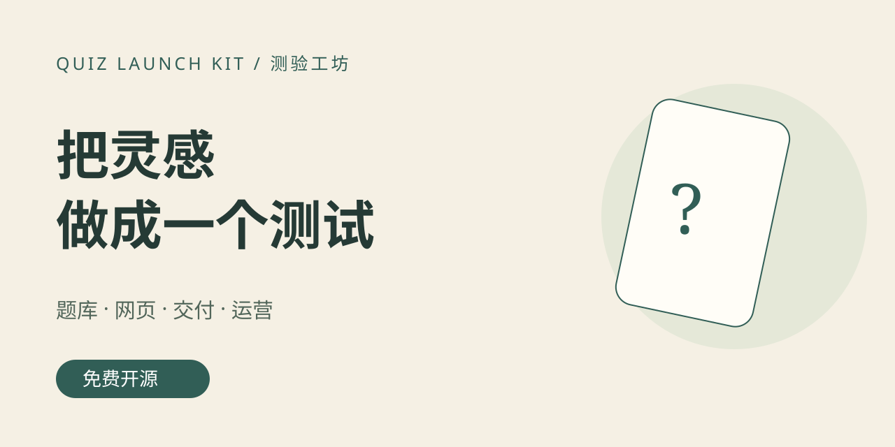

# 测验工坊｜把一个灵感，做成可交付的趣味测试

**免费开源的测试产品制作课 + 离线网站生成器 + 兑换码交付参考。**



想做“哪座城市适合我的生活节奏”“我像哪种故事角色”，却不想每次从零写网站？
这里把选题、情境题、结果解释、网页制作、定价、交付、售后和复盘放在一条可操作的路径上。

**从这里开始：[下载整个项目](https://github.com/608tt/quiz-launch-kit/archive/refs/heads/main.zip) → 解压 → 双击 `studio.html`。** 无需安装、注册、API key 或付费模型。

## 你会得到什么

| 内容 | 可以直接做什么 |
|---|---|
| 离线生成器 | 改标题、三种配色、导入/编辑 JSON，导出独立 HTML 网站 |
| 原创示例 | 12 道情境题、4 个偏好维度、8 种城市意象；支持返回修改与重测 |
| 可解释结果 | 摘出实际选择、展示偏好刻度、提示相近结果；导出 PNG 卡片和打印报告 |
| 交付参考 | Python + SQLite 的一次性兑换码、24 小时会话、到期与撤销 |
| 免费课程 | 从需求验证到上架、交付、退款处理和复盘的操作清单 |
| 内容包 | GitHub 标题、项目封面与头像 SVG、小红书标题/图文/商品页/客服模板 |

## 三条路径

1. **先做出来：** [新手 10 步](docs/START-HERE.md)，使用内置示例，再换自己的主题。
2. **做得有区别：** [题库与评分](docs/DESIGN.md) + [AI 提示词](docs/PROMPTS.md)，别只换标题。
3. **尝试交付：** [完整 SOP](docs/SOP.md) → [部署与兑换码](docs/DELIVERY.md) → [发布内容包](docs/CONTENT.md) → [收益核算](docs/METRICS.md)。

## 已实现与尚未接通

已实现网页生成、计分、解释、图片保存、离线运行及本地兑换码服务逻辑。**没有接入小红书订单 API、支付回调、官方自动发货或真实店铺，也没有真实成交验证。** 这些依赖经营者的类目资质、平台许可和部署环境。不要把参考服务直接宣称为成熟电商系统。

趣味测试不是科学心理测量。“城市”是原创文学意象，不是定居推荐；不用模糊好话伪装准确率，不承诺赚钱。公开模板也不是稀缺资源：商业版本应有原创题库、持续交付和服务价值，不宜把本仓库的免费示例包装为独家内容出售。

## 开发与验证

```sh
python3 build.py
node --test tests/*.test.cjs
python3 -m unittest discover -s tests -p 'test_*.py' -v
```

Python 3.10+；Node 22+ 仅用于测试。生成器本身不需要它们。修改源码后运行 build.py 重建离线版。详见 [验证记录](docs/VALIDATION.md) 与 [来源和规则核验](docs/RESEARCH.md)。

## 项目结构

- `studio.html`：已构建离线生成器；`index.html`：开发入口（需 HTTP）。
- `engine.js` / `runtime.js` / `builder.js`：校验计分、答题体验、生成导出。
- `examples/city.json`：完整题库及结果，改主题以此为格式样板。
- `server/app.py`：单产品兑换码服务；数据库、真实码、订单信息不能提交 GitHub。
- `assets/`：可编辑排版封面与头像；`docs/`：完整课程。

MIT：可修改、商用、分发，保留许可。平台规则、史料和第三方品牌不因本许可而获授权。欢迎提交可复现的问题与原创题库改进。
